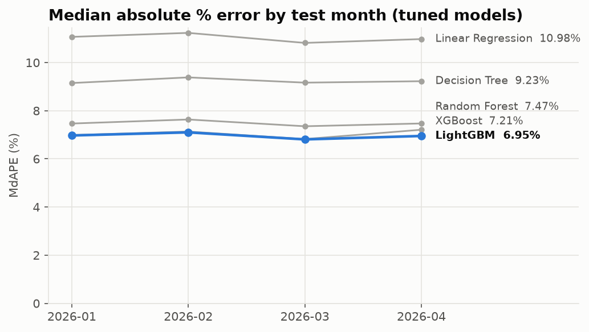
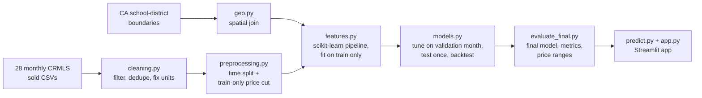
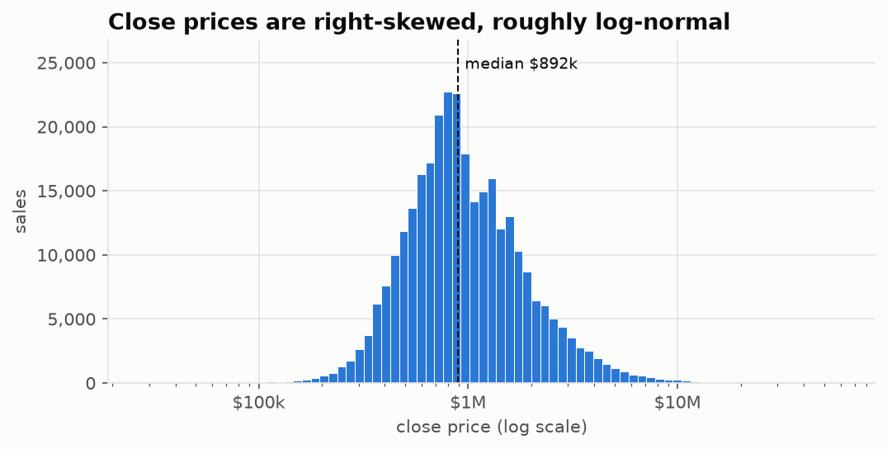
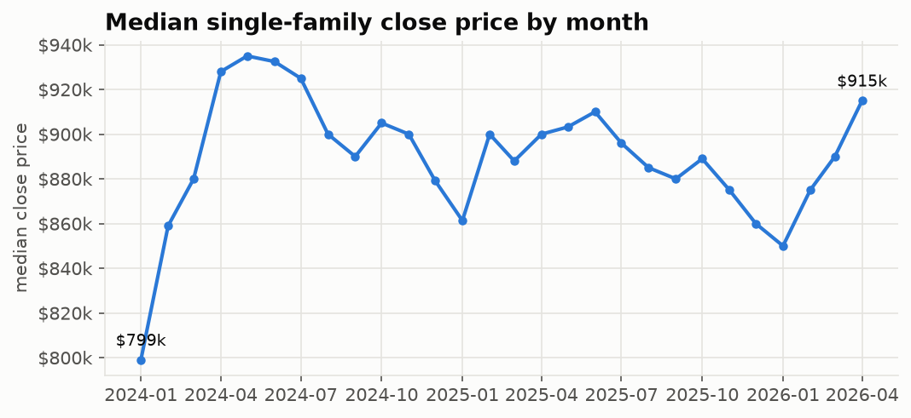
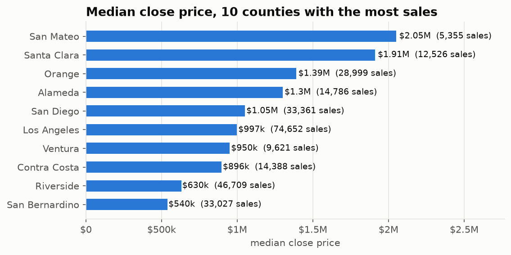
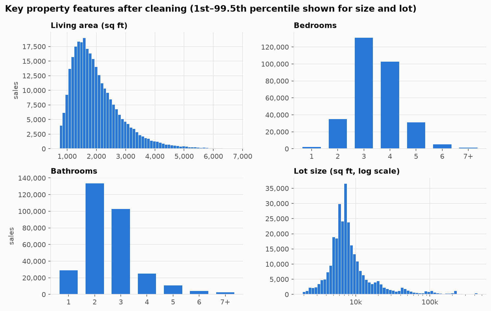
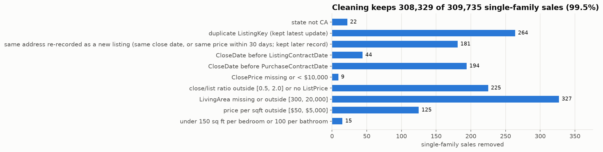
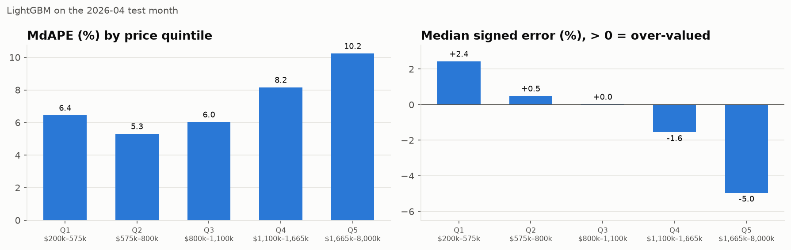

# California Home Price AVM

An automated valuation model (AVM) that predicts the sale price (`ClosePrice`) of California single-family homes from their listing details, built on 28 months of closed CRMLS sales. IDX Exchange Data Science internship, Fall 2026 — Ethan Chung.

## Summary

- **Final model:** LightGBM (gradient-boosted trees) on 33 input columns: size, rooms, age, lot, amenities, location, school districts, flooring and season.
- **Accuracy on the held-out test month (April 2026, 12,318 homes):** median absolute error **6.95%** of the sale price, R² **0.912**; 64% of homes valued within ±10%. The Linear Regression baseline scores 10.98% / 0.827 on the same homes.
- **Stable over time:** 6.8–7.1% in each of four test months (January–April 2026).
- **Honest ranges:** every estimate comes with 80% and 90% likely ranges that held up on the test month (78–81% and 88–91% coverage).
- **App:** `streamlit run app.py` values any home from a ZIP code and its details.



## Contents

[Pipeline](#pipeline) · [Data](#data) · [Cleaning](#cleaning) · [Program rules](#program-rules-pdfs-and-slack) · [Split and validation](#split-and-validation) · [Features](#features) · [Models and tuning](#models-and-tuning) · [Results](#results) · [Prediction app](#prediction-app) · [Reproduce](#reproduce) · [Assumptions](#assumptions) · [Limitations](#limitations) · [Next steps](#next-steps) · [Repo layout](#repo-layout) · [Project timeline](#project-timeline)

## Pipeline



## Data

- **Source:** CRMLS closed sales from the IDX Exchange data feed, 28 monthly files (`CRMLSSold202401` – `CRMLSSold202604`) downloaded **2026-09-29** with `data/crmls_sold.py` (API key read from the `IDX_PROXY_KEY` environment variable). Field definitions follow the Trestle Property Metadata. Raw data is git-ignored and never committed.
- **Population:** `PropertyType = Residential` and `PropertySubType = SingleFamilyResidence` in California, closed January 2024 – April 2026.
- **External data:** [CA School District Areas 2024-25](https://data.ca.gov/dataset/california-school-district-areas-2024-25) boundaries (data.ca.gov), downloaded 2026-10-08.
- **Column reference:** `docs/data_dictionary.csv` (description, type and % missing for every column).

Key findings from exploration (`notebooks/01_exploration.ipynb`):

| | |
|---|---|
|  |  |
|  |  |

- Prices are strongly right-skewed (median $893k, a long tail into the tens of millions), so models predict `log(ClosePrice)` and convert back to dollars.
- The market moved little over the period (monthly median $799k–$935k), with a spring peak each year: seasonality matters more than trend.
- Location dominates price: the median varies more than 6× between counties with 1,000+ sales (Lake vs San Mateo).

## Cleaning

`src/cleaning.py`; every threshold is in `RULES`, and every step's count and percentage is logged in `docs/cleaning_log.csv`. Reasoning: `notebooks/02_preprocessing.ipynb`.

| Step | Rows removed | Rows left |
|---|---|---|
| Raw monthly files (all property types) | | 615,707 |
| Not Residential / single-family | 305,972 | 309,735 |
| State not CA | 22 | 309,713 |
| Status not Closed (safeguard; all rows are Closed) | 0 | 309,713 |
| Duplicate `ListingKey` (same sale re-recorded; latest update kept) | 264 | 309,449 |
| Same address under two listings: same close date, or same price within 30 days (one transaction) | 181 | 309,268 |
| Closed before its listing date / purchase-contract date | 44 + 194 | 309,030 |
| Close price missing or under $10,000 | 9 | 309,021 |
| Close/list price ratio outside [0.5, 2] or no list price (typos, e.g. $970M on a $975k listing) | 225 | 308,796 |
| Living area missing or outside 300–20,000 sq ft | 327 | 308,469 |
| Price per sq ft outside $50–$5,000 | 125 | 308,344 |
| Under 150 sq ft per bedroom or 100 per bathroom (counts impossible for the size) | 15 | **308,329** (99.5% of single-family rows) |

Values that are impossible but don't invalidate the sale are set to missing instead of dropping the row (the model imputes them): year built before 1850 or after the sale (7), beds or baths of 0 or over 20 (189), garage over 20 or parking over 50 spaces (277), coordinates outside California (62). Lot sizes are repaired: 21 filled from acres, 337 values under 10 "sq ft" converted from acres, 395 zero, absurd or ambiguous lots set to missing. The street address is used only for the duplicate check and is then dropped with the other personal fields.



## Program rules (PDFs and Slack)

How the project follows each instruction from the task document, the AVM Best Practices doc, the real-estate primer and the program Slack channels:

| Source | Rule | How it is met |
|---|---|---|
| Task doc | Use only `PropertyType = Residential`, `PropertySubType = SingleFamilyResidence` | first cleaning step |
| Primer | Price analysis on closed sales only | explicit `MlsStatus = Closed` filter (all rows already Closed) |
| Best Practices §02 | Remove ClosePrice ≤ 0, missing target, duplicates (same listing, or same address + close date) | cleaning steps above, with counts and % in `docs/cleaning_log.csv` |
| Best Practices §02 | Remove logical impossibilities: closed before listed, zero square footage, beds/baths inconsistent with living area | cleaning steps above |
| Best Practices §01, Slack | Chronological split: test = latest month, validation = second-latest, never tune on test; rolling backtest at 2+ extra cutoffs | [Split and validation](#split-and-validation) |
| Best Practices §03, Slack | 0.5th / 99.5th percentile ClosePrice cut computed on training data only, frozen for validation and test | `preprocessing.py` |
| Best Practices §04, Slack (Oct 4) | No `ListPrice`, `OriginalListPrice`, `DaysOnMarket`, `ListingContractDate`, `PurchaseContractDate` or anything derived from them (list ratios, list price per sq ft) as model inputs; price per sq ft only from nearby sales, never from the home's own ClosePrice | none are model inputs (`docs/leakage_audit.csv`). The close/list ratio and the home's own price per sq ft are used only to remove data-entry errors during cleaning, which the Slack guidance allows for cleaning checks. The nearest-sales price level was tested as a feature (Week 8) |
| Slack (Oct 4) | Only information available for any address at prediction time | every feature is a property, location or date fact; the app values any address from its details |
| Best Practices §05–07 | Intrinsic + location + time features; deliberate missing-value handling; train-only, leakage-safe pipeline | [Features](#features) |
| Best Practices §08–09 | MdAPE headline with R², MAPE, MAE by price band and geography; baseline next to boosted models; gain larger than noise | [Results](#results) |
| Best Practices §10 | Document cleaning counts, features, tuning, validation, assumptions, limitations, next steps | this README |
| Best Practices §11 | Seeds fixed, environment pinned, data snapshot noted | [Reproduce](#reproduce), [Data](#data) |
| Best Practices §12 | Streamlit app with saved artifacts and a feature-schema assertion | [Prediction app](#prediction-app) |
| Slack | Only code in a public repo named `IDX-Exchange-Data-Science`; no CSV or raw data | `data/` and `models/` are git-ignored |

## Split and validation

Following the IDX Best Practices doc, everything is split by time, never shuffled (`src/preprocessing.py`):

- **Test:** the latest month, **2026-04**. Scored once, after every choice was made.
- **Validation:** the month before, **2026-03**. Used for every choice: training-window length, hyperparameters, feature sets and the final model.
- **Training window:** the X months immediately before validation, with X tried at 3, 6, 12 and 24 months (`docs/split_summary.csv`). For the test score, the chosen setup is refit on the X months right before the test month.
- **Outlier cut:** `ClosePrice` below the 0.5th or above the 99.5th percentile of the **training** window is dropped. The same frozen cutoffs (e.g. $200,000 – $8,050,000 for the final model) are applied to validation and test.
- **Same homes for every model:** each month is scored on one fixed set of homes (cutoffs of the 24 months before it), so windows and models are compared on identical homes.
- **Rolling backtest:** the final setup is refit and rescored with 2026-03, 2026-02 and 2026-01 as the test month.
- **Significance:** differences between models are checked with a paired bootstrap of the test homes (2,000 resamples, 95% interval).

**Metrics** (all in dollars, `src/evaluation.py`):

| Metric | Meaning |
|---|---|
| **MdAPE** (headline) | Median absolute percentage error: half of homes are valued closer than this. Robust to a few extreme misses. |
| MAPE | Mean absolute percentage error; pulled up by large misses. |
| MAE / RMSE | Mean absolute / root-mean-square error in dollars; dominated by expensive homes. |
| R² | Share of the variance in sale prices explained. |
| Within 10% | Share of homes valued within ±10% of the sale price. |
| Median signed error | Direction of bias: > 0 means the typical home is over-valued. |

## Features

33 input columns become 119 model features in the final pipeline (`src/features.py`). Every step that learns from data sits inside one scikit-learn `ColumnTransformer` fit on the training window only.

| Group | Columns | Treatment |
|---|---|---|
| Size | `LivingArea`, `LotSizeSquareFeet` | median imputation + missing flag, log, scaled |
| Rooms and structure | beds, baths, main-level beds, stories, garage and parking spaces, `Levels` | median imputation + missing flag; `Levels` one-hot |
| Age | `property_age` = sale year − year built | median imputation + missing flag |
| Amenities | view, private pool, fireplace, attached garage, basement, waterfront, new construction; `Flooring` | most-frequent imputation + missing flag; flooring split into one 0/1 column per type (types with 500+ training sales) |
| HOA | `hoa_monthly` = fee ÷ payment frequency | median imputation + missing flag |
| Location | latitude, longitude, county | county one-hot; ZIP, city, MLS area and high-school district **target-encoded** with 5-fold cross-fitting, so a home's own price never feeds its own encoding |
| School districts | K-8 and high-school district (spatial join, 99.1% of homes matched), district type, enrollment, state assistance status | districts target-encoded; others one-hot / log |
| Season | `month_sin`, `month_cos` of the sale month | — |

**How features were chosen** (each tested on the validation month; `docs/feature_set_comparison*.csv`):

| Feature idea | Result on validation | Decision |
|---|---|---|
| School-district layer + flooring (Week 6) | lowered MdAPE for all three models of the time (Random Forest 7.50% → 7.40%) | **kept** |
| Bed/bath ratio, sq ft per bedroom (Week 6) | worse for both tree models | dropped |
| Market trend (months since 2024-01) (Week 8) | worse for every model | dropped |
| Price level of the 10 nearest training sales (Week 8) | Linear Regression 10.82% → 9.32%, but no gain for LightGBM / XGBoost | dropped (the final model already learns location) |

**Excluded on purpose** (`docs/leakage_audit.csv` lists every column with its reason): `ListPrice`, `OriginalListPrice`, `DaysOnMarket` and the listing / contract / close dates leak the answer or are only known once the home is listed. Agent and office names, addresses and other personal data are dropped. District race, ethnicity and income shares are not used: a valuation model that learns from neighborhood demographics creates a fair-housing risk. Columns over 60% missing (subdivision, school names, builder) are dropped.

## Models and tuning

Five models go through the identical procedure in `src/models.py`, all predicting `log(ClosePrice)`, with seeds fixed (`random_state=42`). Each is tuned on the 2026-03 validation month over training window × the grid below, keeping the lowest validation MdAPE.

| Model | Search (Week 8, `python src/models.py --tuned`) | Chosen |
|---|---|---|
| Linear Regression (baseline) | window only | 24 months |
| Decision Tree | max depth 12 / 16 / 20 × min leaf 2 / 5 / 10 | 24 months, depth 16, leaf 5 |
| Random Forest (200 trees) | min leaf 1 / 2 × features per split 20% / 33% | 24 months, leaf 2, 33% |
| **LightGBM** (2,000 trees, learning rate 0.03, 80% row and column sampling) | leaves 255 / 511 / 1023 × min leaf 5 / 10 × squared vs absolute error | **24 months, 255 leaves, min leaf 5, absolute error** |
| XGBoost (2,000 trees, learning rate 0.03, 80% sampling) | depth 10 / 12 / 14 × min child weight 1 / 10 × squared vs absolute error | 12 months, depth 10, weight 10, absolute error |

In the earlier searches (`docs/metrics_*__week6.csv`) every model's best result used a 12- or 24-month window, and 12 months beat both 3 and 6 for every model and setting, so the Week 8 search used 12 and 24 only. The absolute-error objective, which on log prices targets the median percentage error directly, was the main gain for the boosted models.

**Final model choice:** LightGBM had the lowest validation MdAPE (6.81%, essentially tied with XGBoost at 6.82%). The test month played no part in the choice.

## Results

All five tuned models on the same 12,318 homes of the April 2026 test month (`docs/metrics_summary.csv`, `notebooks/06_evaluation.ipynb`):

| Test 2026-04 | R² | MdAPE | MAPE | MAE | Within 10% | Backtest MdAPE (2026-01 – 03) | Model file |
|---|---|---|---|---|---|---|---|
| Linear Regression (baseline) | 0.827 | 10.98% | 15.1% | $205k | 46% | 10.8–11.2% | 0.1 MB |
| Decision Tree | 0.854 | 9.23% | 13.7% | $185k | 53% | 9.2–9.4% | 0.7 MB |
| Random Forest | 0.897 | 7.47% | 11.1% | $153k | 61% | 7.4–7.6% | 653 MB |
| **LightGBM (final)** | **0.912** | **6.95%** | **10.6%** | **$143k** | **64%** | **6.8–7.1%** | 19 MB |
| XGBoost | 0.906 | 7.21% | 10.9% | $147k | 63% | 6.8–7.1% | 17 MB |

- **More than noise:** LightGBM beats the baseline by 4.0 MdAPE points (95% paired-bootstrap interval 3.8–4.3), the Random Forest by 0.52 (0.39–0.69) and XGBoost by 0.26 (0.12–0.41). It has the lowest MdAPE of every model in all four test months.
- **Typical accuracy:** 38% of homes within ±5%, 64% within ±10%, 86% within ±20%.
- **By price:** most accurate for $575k–$1.1M homes (MdAPE 5.3–6.1%). Entry-level homes are over-valued by 2.6%; luxury homes above $1.66M are under-valued by 4.9% (MdAPE 10.1%), the weakest segment but far better than the baseline (15.7%, −9.6%).
- **By region:** LightGBM or XGBoost is the best model in every county with 200+ test homes (LightGBM in 7 of 10); easiest are Riverside and San Bernardino (5.7–5.9%), hardest is Alameda (9.9%).
- **By home:** error grows with age (4.5% for homes 0–5 years old, 10.5% for homes over 80) and is highest for the largest fifth of homes (8.5%).
- **What drives it:** ZIP code (37% of the model's gain), city (10%), living area (10%), then lot size, coordinates and age.



**Prediction ranges** (`docs/prediction_intervals.csv`): for each fifth of predicted prices, the 80% and 90% ranges are the middle 80% / 90% of the final model's actual ÷ predicted ratios on the validation month. On the test month they contained 78–81% and 88–91% of homes in every band. They are wider upward for expensive homes (up to +26% at 80%).

## Prediction app

A local Streamlit app (`app.py`, logic in `src/predict.py`) values one home:

- **Inputs:** ZIP code plus the home's details; anything optional can stay blank and is imputed exactly as in training.
- **Auto-filled:** city, county, MLS area and coordinates from the ZIP code (its most common values in past sales), school districts from the coordinates, age at the valuation date.
- **Output:** estimated value, 80% and 90% likely ranges, school districts and a map.
- **Safeguards:** the input columns are asserted to match the model's training schema before every prediction; warnings appear for a living area outside the training range, a ZIP with fewer than 5 past sales, coordinates outside California, or an estimate outside the training price range.
- **Checked:** given the same inputs, the app's prices match the trained pipeline exactly on 3,000 test homes. Filling blanks from the ZIP code does not change accuracy (MdAPE 7.08% vs 7.10%, checked before the Week 10 cleaning update).

```bash
streamlit run app.py          # opens http://localhost:8501 (after the steps in Reproduce)
```

It runs locally only: the model file (19 MB) and the data are git-ignored.

## Reproduce

Requirements: Python 3.11; on macOS, the OpenMP runtime for LightGBM / XGBoost (`brew install libomp`). Every package version is pinned in `requirements.txt`, and seeds are fixed (`random_state=42`).

```bash
pip install -r requirements.txt

# 1. Data: put the 28 monthly CRMLSSold*.csv files in data/ (or download with data/crmls_sold.py),
#    then the school-district boundaries
mkdir -p data/external && curl -L -o data/external/ca_school_district_areas_2024_25.zip \
  "https://gis.data.ca.gov/api/download/v1/items/b0e3b936426a47ce9d9a2e77e2bb86cc/shapefile?layers=0"

# 2. Clean, split, features
python src/cleaning.py        # data/processed/sfr_clean.csv (+ .parquet), docs/cleaning_log.csv
python src/make_figures.py    # docs/figures/ (exploration charts)
python src/preprocessing.py   # docs/split_summary.csv
python src/geo.py             # data/processed/school_districts.parquet
python src/features.py        # docs/leakage_audit.csv

# 3. Models and evaluation
python src/models.py --tuned  # every model, Week 8 search (~2 hours; keep the computer awake)
python src/evaluate_final.py  # final model, docs/metrics_summary.csv, docs/prediction_intervals.csv, figures

# 4. App
streamlit run app.py
```

Earlier stages can be rerun on their own: `python src/models.py` (Week 5–7 grids, about 35 minutes), `python src/models.py --features week5 random_forest` (one model, another feature set). Notebook outputs are stripped on commit (`nbstripout`), so run the notebooks locally to see their charts and tables; they load the saved results rather than retraining.

## Assumptions

Each of these is a judgment call made in the code; the reasoning and checks are in `notebooks/02_preprocessing.ipynb` unless noted.

| Assumption | Where |
|---|---|
| Rows with the same `ListingKey` are one sale recorded more than once; the most recently updated record is correct (a record with no update date counts as the oldest). | `cleaning.py` |
| A close/list ratio outside [0.5, 2] is a typo, not a real sale. | `cleaning.py` |
| A lot size under 10 "sq ft" is acres typed into the square-feet field (99.7% of those lots were smaller than the house itself); lots of 10–499 sq ft have unknown units and become missing. | `cleaning.py` |
| `BasementYN` and `WaterfrontYN` are only ever recorded as True, so missing means No. | `cleaning.py` |
| `latfilled` / `lonfilled` mark coordinates that were imputed upstream; they are kept as-is (method unknown). | `cleaning.py` |
| An HOA fee with no stated payment frequency is monthly (the most common frequency). | `features.py` |
| Age is measured at the sale date (at the valuation date in the app). | `cleaning.py`, `predict.py` |
| 2024-25 school-district boundaries apply to every sale from 2024 to 2026. | `geo.py` |
| A home's price level is the latest in the training data: tree models cannot extrapolate a trend, and a trend feature made validation worse. | `features.py` |
| In the app, a blank city, county, MLS area or coordinate takes the most common value among past sales in the same ZIP code. | `predict.py` |

## Limitations

- **The 2026-03 backtest month is also the validation month**, so it is not an independent check; 2026-01 and 2026-02 are.
- **Cleaning rules that use the sale price** (close/list ratio, price per sq ft, minimum price) also apply to the test month. They remove 359 sales (0.12%), mostly typos, so error on unfiltered data would be slightly higher.
- **One market, one period:** CRMLS coverage (Southern and Central California, parts of the Bay Area), 2024–2026. Accuracy elsewhere, or in a sharply changing market, is unknown.
- **No condition or renovation data.** The worst 5% of predictions are mostly over-valued (76%) older homes (median age 61 vs 49), likely fixer-uppers or distressed sales.
- **Luxury homes** above $1.66M are under-valued by about 5% and have twice the typical error of mid-priced homes.
- **Model selection uses a single validation month**, so close calls (LightGBM 6.81% vs XGBoost 6.82%) are within noise.
- **School-district boundaries are a 2024-25 snapshot.**
- **Imputed coordinates** in the `_filled` files come from an unknown method (open question for the team).

## Next steps

Concrete improvements, roughly in order of expected value:

1. **Condition from listing text.** Flag words like "fixer", "as-is", "remodeled" in the public remarks (written before the sale, so not leakage). Condition is the most likely cause of the largest misses.
2. **Repeat sales.** A home's previous sale price, adjusted for market movement, is a strong signal; it needs a stable property ID (e.g. a hashed parcel number) instead of the dropped address fields.
3. **Time-weighted comparable sales.** Nearest-sales prices helped Linear Regression a lot; weighting recent and nearby sales more may help the boosted models too.
4. **Luxury segment:** sample weights or a separate model for homes above about $1.7M.
5. **More robust selection:** choose settings on several validation months instead of one, and search learning rate and tree count as well (e.g. with Optuna).
6. **Ensemble:** average LightGBM and XGBoost with weights chosen on validation.
7. **Monthly retraining and monitoring:** rerun the pipeline as each month closes and alert if MdAPE drifts above about 8%.
8. **Fair-lending check:** compare error and bias across neighborhoods by demographics, without using demographics as features.
9. **Deployment:** host the model file so the app can run on Streamlit Community Cloud.

## Repo layout

```
app.py                    Streamlit app: value one home with the final model
data/                     raw CRMLS CSVs + download script (git-ignored, never commit)
  external/               school-district boundary shapefile
  processed/              sfr_clean.csv (+ .parquet), school_districts.parquet
docs/
  data_dictionary.csv     every column: description, type, % missing
  cleaning_log.csv        rows removed / values changed by each cleaning step
  split_summary.csv       rows and price cutoffs for each training-window length
  leakage_audit.csv       every column: used as a feature or excluded, and why
  feature_set_comparison.csv       Week 6 feature sets, validation and test
  feature_set_comparison_week8.csv Week 8 feature ideas, validation only
  metrics_<model>__<features>[__tuned].csv  selection grid, test and backtest for each run
  metrics_summary.csv     final table: every tuned model by stage, month, price band and county
  prediction_intervals.csv  final model's 80% / 90% ranges per predicted-price band, with test coverage
  figures/                charts in this README
models/                   trained models (git-ignored; rebuilt by src/models.py)
notebooks/
  01_exploration.ipynb    exploratory data analysis
  02_preprocessing.ipynb  cleaning rules, split, preprocessing pipeline
  03_baseline_model.ipynb Linear Regression baseline
  04_model_comparison.ipynb      Decision Tree and Random Forest vs baseline
  04b_feature_engineering.ipynb  school districts, flooring, old vs new feature sets
  05_advanced_models.ipynb       LightGBM and XGBoost
  06_evaluation.ipynb     final evaluation: model choice, segments, largest misses, ranges
src/
  cleaning.py             cleaning pipeline (thresholds in RULES)
  preprocessing.py        time split, train-only price cut, shared scoring set
  features.py             feature sets, preprocessing pipeline, leakage audit
  geo.py                  school-district spatial join
  models.py               model registry, selection on validation, test, backtest
  evaluation.py           metrics, breakdowns, paired bootstrap
  evaluate_final.py       final model choice, metrics_summary.csv, ranges, figures
  predict.py              single-home valuation used by the app
  make_figures.py         exploration charts
```

## Project timeline

| Week | Work | Notebook / output |
|---|---|---|
| 1–2 | Data access, column notes, exploration | `01_exploration.ipynb` |
| 3 | Cleaning, time split with tunable window, train-only price cut, preprocessing pipeline | `02_preprocessing.ipynb`, cleaned CSV |
| 4 | Linear Regression baseline: test MdAPE 11.2% (Week 5 features) | `03_baseline_model.ipynb` |
| 5 | Decision Tree and Random Forest: Random Forest 7.6% | `04_model_comparison.ipynb` |
| 6 | School-district layer and flooring: Random Forest 7.5% | `04b_feature_engineering.ipynb` |
| 7 | LightGBM and XGBoost: 7.15% | `05_advanced_models.ipynb` |
| 8 | Fixed the scoring set, wider tuning, final evaluation and price ranges: LightGBM 6.96% | `06_evaluation.ipynb`, `metrics_summary.csv` |
| 9 | Streamlit prediction app | `app.py` |
| 10 | Cleaning aligned with every PDF and Slack rule (address duplicates, bed/bath consistency, closed status), full rerun: **LightGBM 6.95%**; documentation (this README) | `README.md` |
